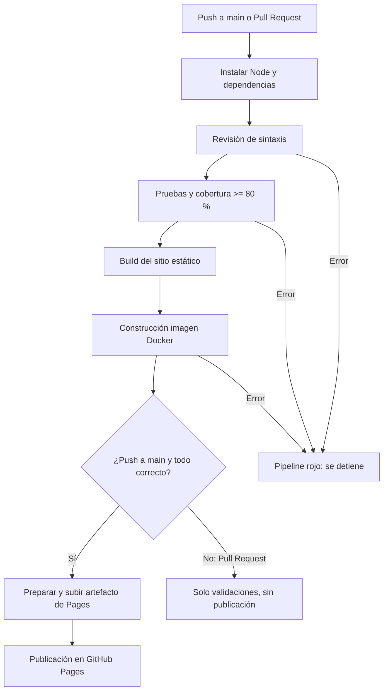

# Práctica 3: Configuración básica de un Pipeline CI/CD — ITLA

Aplicación de gestión de tareas construida con **Node.js, Express y JavaScript**, con pruebas **Jest y Supertest** y automatización de **GitHub Actions**. La publicación se realiza en **GitHub Pages**, de manera gratuita.

> **Nota importante:** GitHub Pages publica únicamente archivos estáticos. La demostración publicada funciona con `localStorage` (persistencia en el navegador); en `localhost` el mismo frontend consume la API Node.js/Express, cuyos datos se guardan en memoria. **GitHub Pages no hospeda la API de Express.**

## 1. Objetivo

Automatizar las actividades de integración y entrega continua: revisión de sintaxis, pruebas unitarias/de integración, análisis de cobertura, generación del sitio, construcción Docker y publicación en Pages **solo si las verificaciones pasan**.

## 2. Tecnologías

| Tecnología | Función |
|---|---|
| Node.js 22 | Entorno de ejecución JavaScript |
| Express 4 | API REST de tareas |
| Jest 29 | Pruebas y cobertura |
| Supertest 7 | Pruebas de integración HTTP |
| Git y GitHub | Control de versiones y repositorio público |
| GitHub Actions | Automatización del pipeline |
| Docker | Validación opcional de la construcción del contenedor |
| GitHub Pages | Hosting de la interfaz HTML/CSS/JS |

## 3. Estructura

```text
practica3-cicd-itla/
├── .github/workflows/ci.yml  # Pipeline
├── docs/
│   ├── GUIA_DESPLIEGUE.md    # Publicación paso a paso
│   ├── PIPELINE.md           # Explicación de etapas
│   └── DEMO_ROJO_VERDE.md    # Demostración de fallos y corrección
├── public/
│   ├── index.html            # Interfaz
│   ├── style.css             # Estilos
│   └── app.js                # Cliente: API o localStorage
├── scripts/build.js          # Preparación del sitio para Pages
├── src/
│   ├── app.js                # API Express
│   ├── tareas.js             # Reglas de validación
│   └── server.js             # Arranque del servidor
├── tests/
│   ├── tareas.unit.test.js   # Pruebas unitarias
│   └── app.test.js           # Pruebas de integración
├── Dockerfile
├── .gitignore
├── .nvmrc
├── CONTRIBUTING.md
└── package.json
```

## 4. Funcionalidades

- Listar tareas.
- Crear tareas validando títulos de entre 1 y 80 caracteres.
- Marcar y desmarcar una tarea como completada.
- **Nueva función para Práctica 3:** eliminar tareas.
- Evitar la repetición de identificadores después de borrar elementos.
- Contador de pendientes y total de tareas en la interfaz.
- API de salud (`GET /health`) y métricas (`GET /metrics`).
- Versión demostrativa funcional en Pages, sin backend ni servicios de pago.

### API REST (cuando ejecutas `npm start`)

| Método | Ruta | Respuesta esperada |
|---|---|---|
| GET | `/health` | `200`, `{ "estado": "ok" }` |
| GET | `/metrics` | `200`, métricas de solicitudes y tareas |
| GET | `/api/tareas` | `200`, lista de tareas |
| POST | `/api/tareas` | `201` o `400` si el título es inválido |
| PATCH | `/api/tareas/:id` | `200` o `404` |
| DELETE | `/api/tareas/:id` | `204` o `404` |

**Ejemplo de creación:** `POST /api/tareas` con JSON `{ "titulo": "Configurar pipeline" }`.

## 5. Instalación y uso local

Requisitos: Git y Node.js **20 o superior** (recomendado: Node.js 22). Desde la carpeta del proyecto:

```bash
npm install
npm run lint
npm test
npm run build
npm start
```

Abre `http://localhost:3000`. Las tareas en modo API se guardan en memoria y se reinician con el servidor.

### Comandos útiles

| Comando | Resultado |
|---|---|
| `npm run lint` | Revisa sintaxis JavaScript |
| `npm test` | Ejecuta pruebas y genera `coverage/` |
| `npm run build` | Crea la carpeta `dist/` para Pages |
| `npm run check` | Ejecuta lint + tests + build |
| `npm start` | Inicia API y frontend local |

**Cobertura mínima configurada:** 80 % en sentencias, ramas, funciones y líneas, evaluada por Jest en `src/app.js` y `src/tareas.js`. Si está por debajo, `npm test` falla y el pipeline se detiene.

## 6. ¿Cómo funciona el pipeline?



Archivo de configuración: `.github/workflows/ci.yml`.

1. **Disparadores:** `push` y `pull_request` de `main` y ejecución manual (`workflow_dispatch`).
2. **Instalar:** ejecuta `npm install` con Node.js 22.
3. **Lint:** comprueba sintaxis con `node --check` (sin dependencias extra).
4. **Pruebas:** Jest y Supertest; umbral de cobertura 80 %.
5. **Build:** copia el frontend a `dist` con el script de construcción.
6. **Docker:** construye una imagen, **sin publicarla** en un registro.
7. **Deploy:** únicamente después de pasar validaciones y en `push` a `main`, GitHub Actions publica `dist/` en GitHub Pages.

> Esta práctica implementa **CI y CD como entrega/despliegue del frontend estático**. El backend Express se prueba y su imagen Docker se construye, pero **no se despliega** en Pages.

## 7. Publicación del proyecto

Consulta [Guía de despliegue](docs/GUIA_DESPLIEGUE.md). Para publicación, crea un repositorio **público** vacío, sube los archivos con su carpeta `.github`, habilita **Settings → Pages → Build and deployment → Source: GitHub Actions** y comprueba la pestaña **Actions**.

La dirección será parecida a `https://TU_USUARIO.github.io/TU_REPOSITORIO/`, **solo cuando se publique correctamente**.

## 8. Evidencia de la práctica

- Captura del repositorio público, mostrando `.github/workflows/ci.yml`.
- Captura de `npm test` con las pruebas y cobertura.
- Captura de un pipeline verde y otro rojo (ver [Demo rojo/verde](docs/DEMO_ROJO_VERDE.md)).
- Captura del sitio de GitHub Pages con una tarea creada y completada.
- Dirección real del repositorio y de Pages para el profesor.
- Video o PPT que explique instalación, pruebas, falla intencional, corrección y despliegue.

**Importante:** no declarar exitosos pasos que aún no se hayan comprobado en tu cuenta de GitHub.

## 9. Contribución

Ver [CONTRIBUTING.md](CONTRIBUTING.md).

## 10. Limitaciones y mejoras futuras

- Las tareas del backend permanecen en memoria: no hay base de datos.
- La demo pública usa `localStorage`, por lo cual las tareas dependen del navegador utilizado.
- No hay despliegue del servidor Express a un hosting: Pages solo admite contenido estático.
- Como mejora futura: agregar SQLite, ESLint y publicación de imagen a GHCR.

## 11. Fuentes oficiales

- [GitHub Pages: workflows personalizados](https://docs.github.com/en/pages/getting-started-with-github-pages/using-custom-workflows-with-github-pages)
- [GitHub Actions: documentación](https://docs.github.com/en/actions)
- [Jest: coverage](https://jestjs.io/docs/configuration#coveragethreshold-object)
- [Express](https://expressjs.com/)
